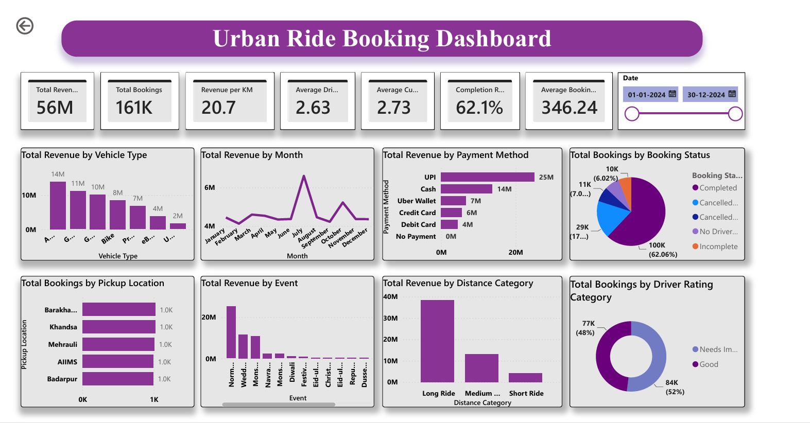

# 🚖 Urban Ride Booking Analytics Dashboard

An interactive Power BI dashboard built on **161,000+ ride-booking records** to track revenue, bookings, vehicle usage, payment trends and operational efficiency.

📄 [View full dashboard as PDF](Urban%20Ride%20Booking%20Analytics%20Dashboard.pdf)

---

## 📌 Project Overview
This project analyzes a full year of ride bookings (Jan to Dec 2024) to understand what drives revenue and where operations can improve. Raw data was cleaned and transformed in Power Query, modeled for reporting, and visualized through interactive KPI cards, charts and a date filter.

## 📊 Key Metrics

| Metric | Value |
|---|---|
| Total Revenue | 56M |
| Total Bookings | 161K |
| Revenue per KM | 20.7 |
| Average Driver Rating | 2.63 |
| Average Customer Rating | 2.73 |
| Completion Rate | 62.1% |
| Average Booking Value | 346.24 |

## 🔍 Key Insights
- **Payments:** UPI is the top payment method with 25M in revenue, followed by Cash (14M) and Uber Wallet (7M).
- **Distance:** Long rides generate the most revenue among distance categories.
- **Seasonality:** Revenue peaks in July.
- **Events:** Normal days bring in the most revenue (about 25M), followed by wedding and monsoon periods.
- **Booking status:** About 62% of bookings (100K) are completed. The rest are cancelled, incomplete or had no driver found, which shows room to improve completion.
- **Driver ratings:** 52% of bookings fall in the "Needs Improvement" rating category and 48% in "Good".

## 🧩 Dashboard Features
- Interactive KPI cards for revenue, bookings, revenue per KM, completion rate, average booking value and average driver and customer ratings
- Date range slicer for filtering the whole report
- Revenue analysis by vehicle type, month, payment method, event and distance category
- Booking analysis by status, pickup location and driver rating category

## 🛠️ Tools & Skills
- **Power BI Desktop:** report design and visualization
- **Power Query:** data cleaning and transformation
- **DAX:** measures for revenue, revenue per KM, completion rate and average booking value
- **Data Modeling:** structuring tables and relationships for reporting

## 📁 Repository Contents

| File | Description |
|---|---|
| `dashboard-overview.png` | Dashboard screenshot |
| `Urban Ride Booking Analytics Dashboard.pdf` | Full dashboard export |

## 👤 Author
**Suyash Dabholkar**
GitHub: [@suyashdabholkar](https://github.com/suyashdabholkar)
